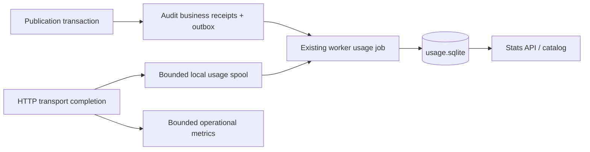

# Доступ, upload admission и статистика v1

Дата: 2026-10-20. Статус: проектное решение; сервер ещё не реализован.
Уточняет [API](API.md), [SECURITY](SECURITY.md) и [DATA_MODEL](DATA_MODEL.md).
Числа ниже — начальные policy defaults, не результаты нагрузочного теста.

## 1. Кто и как получает доступ

Private bootstrap допускает operator-managed accounts: local CLI создаёт account,
назначает membership и выдаёт первый token. Для публичного запуска v1 обязателен
self-service сценарий ниже: обычный publisher регистрируется без operator.
CLI разработчика и CI работают через HTTPS API; отдельный CI account получает
только нужные refs и не является operator.

### 1.1. Самостоятельная регистрация и первый publish

1. Разработчик запускает `sputnik pkg login --registry @main`. CLI получает
   через registry API device-login attempt, показывает короткий code и адрес
   GitHub для подтверждения. На машине без браузера code можно открыть на другом
   устройстве. Собственный frontend, кабинет, cookies и callback URL не нужны.
2. Registry использует GitHub.com OAuth App с включённым
   [Device Flow](https://docs.github.com/en/apps/oauth-apps/building-oauth-apps/authorizing-oauth-apps#device-flow),
   без repository permissions. Backend опрашивает provider с учётом его interval,
   после подтверждения получает identity через `GET /user`. GitHub access token
   используется только в памяти для этой проверки и не передаётся CLI.
   Пароль registry и обязательный email для входа в v1 не вводятся.
3. CLI показывает подтверждённую identity. Для нового account разработчик
   выбирает в терминале свободный personal namespace, например `alice`, по
   grammar publisher из [CLIENT](CLIENT.md). GitHub login — только подсказка:
   совпадение login не даёт прав на namespace. Reserved names отклоняются;
   conflict позволяет выбрать другое имя в пределах verified attempt TTL.
4. В одной DB transaction создаются account, external identity, один personal
   namespace и owner membership. Identity уникальна по `(provider, subject)`,
   для GitHub subject — numeric user ID, а не login/email. Account handle при
   создании совпадает с выбранным slug; дальнейшая identity не выводится из handle.
   Повторный вход находит тот же account, GitHub rename не меняет namespace.
5. Завершение login выдаёт первый registry API token без уже существующего token.
   CLI сохраняет его в credentials для exact registry origin. Для обычной работы
   personal token включает read, create/publish в personal namespace,
   `token:manage` и `publisher-key:manage`; CLI явно показывает запрошенные права
   и TTL. Для CI создаётся отдельный token с exact refs и меньшими правами.
6. Через `pkg key add` publisher регистрирует свой Ed25519 **public** key для
   подписанного public publish. Private signing key остаётся локально.
   `pkg token list/create/revoke`, `pkg key list/add/revoke` и `pkg whoami`
   обращаются к JSON API; HTML pages не требуются.

Login completion выдаёт scopes только в пределах live account permissions.
`namespace:publish:<slug>` — selector для packages этого namespace, а не обход
package ACL: публиковать существующий package по-прежнему может только его
owner/publisher. Exact `package:publish:<ref>` — подмножество такого selector;
`token:manage` позволяет делегировать только подмножество scopes/expiry своего
token. Namespace create scope нужен отдельно. Exact scope на будущий package
можно выдать при праве создавать его в namespace; это не reservation имени.
Ни login, ни personal token не дают operator privileges.

Без согласования доступны standard packages без native payload. Native source,
prebuilt, runtime/SDK providers и bundles сохраняют native admission policy;
`native-large` и unscoped names требуют отдельных operator grants. Регистрация
сама по себе не снимает эти ограничения и не резервирует дополнительные namespaces.

| `registration` | Создание новых accounts |
|---|---|
| `closed` — default private bootstrap | Только local operator provisioning; существующие linked accounts могут входить |
| `open` — public self-service | Проверенная GitHub identity + самостоятельный выбор personal namespace |

`registration`, `read_access` и signing `trust_profile` независимы. Публичное
чтение не открывает регистрацию автоматически. Переключение в closed запрещает
новые accounts, не отзывает существующие. Запуск public self-service требует
готового R8 gate, а не только значения config.

### 1.2. Device-login attempt, защита и восстановление

Registry владеет provider device code; CLI получает отдельный 256-bit login
secret для poll/complete/cancel конкретного attempt. В DB хранится его digest;
secret принимается только в Authorization header на login endpoints и не
авторизует package/token/key API. Provider device code хранится только в bounded
memory web process до exchange/expiry; restart завершает pending attempts с
ошибкой, требуется повторить login. GitHub access/refresh tokens не сохраняются.
Нет browser sessions и cookie auth; дополнительный encryption backend не нужен.

Pending TTL — минимум provider expiry и 15 min. Verified identity действует
5 min для выбора namespace и однократного token issue. Provider polling
сериализован per attempt, соблюдает interval/slow_down и прекращается после
deny/expiry; параллельные CLI polls не ускоряют его. Общий provider request budget
и лимит attempts не позволяют каждому HTTP poll порождать новый outbound request.
Completion атомарно фиксирует account/namespace/token и consumed attempt.
Повторный complete не выдаёт новый secret. При потере ответа CLI отменяет attempt
с revoke только выданного им token и повторяет login; account/namespace сохраняются.
После expiry для revoke потерянного token нужен новый login. TTL cleanup attempt
сам по себе не отзывает успешно выданный token.

CLI показывает registry origin, provider identity и запрошенные scopes до
completion; ожидаемый account при повторном login должен совпадать. Codes,
login secrets и tokens не попадают в URL/argv/logs/audit/analytics; все auth ответы
`no-store`, API не включает browser CORS. `pkg logout` отзывает текущий registry
token и удаляет local credentials; остальные tokens отзываются отдельно.
При сетевой ошибке CLI сообщает, что server-side revoke не подтверждён.

Один provider subject создаёт максимум один account, в том числе после suspension.
Имена account/namespace не переиспользуются автоматически после закрытия.
Email/login не используются для автоматического merge/link accounts.
Потеря GitHub account — audited operator recovery с проверкой доказательств
владения; автоматический reset по email и самостоятельное linking других
providers не входят в v1. При недоступном GitHub новые входы возвращают ошибку;
действующие registry API tokens продолжают работать в пределах их TTL.

Начальные auth limits: start 5/min/IP (burst 2), 3 pending attempts/IP, 64 global;
provider calls максимум 30/min global. Poll не чаще provider interval, complete
10/min/attempt (burst 3), successful signup 5/hour/IP с operator override для
shared networks. Credential mutations — 10/min/account (burst 3), body до 16 KiB.
Перед start резервируется capacity до запроса provider; protected transient
state имеет общий storage budget. Counters bounded TTL, attempts очищаются по TTL.
Это abuse defaults, не доказательство «один человек».

### 1.3. API tokens и проверка прав

API принимает `Authorization: Bearer <opaque-token>`. Secret — 256 random bits,
в DB хранится SHA-256 digest, display prefix, label, account, scopes, expiry и
revocation. Secret выдаётся один раз. Default TTL — 30 days, maximum 90 days;
operator может задать более короткую policy для CI. Delegation не может продлить
доступ за expiry выдающего token или расширить его scopes. Tokens не передаются
в URL, CLI argv или telemetry; local credentials имеют mode 0600, CI использует
secret environment. Token принадлежит конкретному registry instance.

Authorization на каждом mutation:

```text
effective access = token scopes
                 ∩ live account/namespace/package permissions
                 ∩ enabled admission/profile grants
```

Основные scopes: `registry:read`, `package:publish:<ref>`, `package:yank:<ref>`,
`package:owners:<ref>`, `package:stats:<ref>`,
`namespace:create-package:<publisher>`, `namespace:publish:<publisher>`,
`token:manage`, `publisher-key:manage`.
Namespace owner/maintainer может создавать packages согласно membership;
существующий package изменяют его owner/publisher согласно operation policy.
Manage owners требует owner; aggregate publication stats доступны его
owners/publishers с stats scope. Native admission и `native-large` grants
назначает operator; ownership само по себе не повышает эти права.

Для initial publish namespace create scope покрывает созданную этим actor
reservation; дальнейшие versions/variants требуют package publish scope.
Unscoped names сохраняют explicit operator grant. Ed25519 publisher signature
проверяет происхождение artifact и существует отдельно от API authorization.

Create, PUT admission и commit проверяют текущие права; окончательная publication
повторяет проверку после validation. Token revoke/suspension до final commit
не позволяет завершить новую публикацию. Длинный upload периодически проверяет
revocation, а finalize обязательно проверяет её под transaction; наблюдённый
revoke прекращает приём и запускает cleanup. Session сохраняет initiating token
identity; смена credentials не перепривязывает начатую session после revoke.
Уже выданные клиенту bytes
скачивания не отзываются задним числом.

Deployment mode задаётся независимо от `trust_profile` подписи:

| `read_access` | Read API и downloads |
|---|---|
| `authenticated` — default private deployment | Active account + `registry:read` |
| `public` — explicit operator setting | Anonymous reads опубликованных доступных artifacts |

V1 использует один read policy на registry, без per-package private ACL.
`/capabilities` доступен без token и содержит только публичную конфигурацию;
`GET /me` и `/me/usage` требуют token. Public mode не открывает write endpoints.
401 включает `WWW-Authenticate: Bearer`; действующий token без права получает 403.

Server identity — HTTPS certificate trusted edge. Backend listener закрыт от
прямого внешнего доступа; identity из произвольных forwarded/user headers не
принимается. Operator CLI использует OS permissions/local control channel;
публичного admin token endpoint нет. Web/worker на первом узле работают через
DB/filesystem, без HTTP-вызовов друг к другу и без publisher tokens. Для будущих
удалённых internal services нужен отдельный workload identity/mTLS adapter.

Transport ориентируется на [RFC 6750](https://www.rfc-editor.org/rfc/rfc6750.html):
HTTPS, Authorization header, bearer challenge и защита secret от утечки.
GitHub Device Flow — provider login adapter; registry не реализует универсальный
OAuth authorization server в v1. Frontend и личный кабинет — optional future work.

## 2. Лимиты одного artifact и активной работы

Profile выбирается для **одного immutable variant**, а не для всей версии.
`bundle=none/runtime/sdk`, native trust и size profile — разные свойства.

| Ресурс | `standard` | `native-large`, operator-enabled |
|---|---:|---:|
| Compressed artifact | 64 MiB | 2 GiB |
| Expanded tar stream, включая framing | 256 MiB | 8 GiB |
| Один regular file | 64 MiB | 4 GiB |
| Archive members | 10,000 | 10,000 |
| Manifest / checksum inventory | по 1 MiB | по 1 MiB |
| Upload total deadline / idle | 10 min / 30 s | 2 h / 30 s |
| Session TTL до принятия commit | 1 h | 4 h |
| Pending compressed reservations, global/account | 512/192 MiB | 8/4 GiB |
| Inspector wall deadline / RSS | 120 s / 512 MiB | 900 s / 512 MiB |

Общие ограничения: два receiving uploads global, один на account; из них максимум
один `native-large` global. Три active sessions на account суммарно по profiles,
64 global. Один inspector worker global. JSON write body — 64 KiB, metadata page —
1 MiB, modules — 2048, exact dependency entries — 256, variants/release — 32.
Native extension source/header inputs — 512; provider SDK assets считаются в
общем archive member budget, а не в старом native-blob лимите 512.

Новые rate/quota defaults:

| Policy | Начальное значение |
|---|---:|
| Publish-session create | 30/min/account, burst 5 |
| Anonymous read requests | 300/min/IP, burst 30 |
| Authenticated read requests | 1000/min/account, burst 100 |
| Concurrent artifact downloads | 8 global, 2 на read principal |
| Upload traffic за rolling 24 h, standard/native-large | 1/10 GiB на account |
| Published logical storage, standard/native-large | 10/100 GiB на quota owner |

Read principal — authenticated account либо IP anonymous клиента. Edge отдельно
ограничивает invalid-auth/request floods, connections и header sizes; verified
identity/rates контролирует application. Proxy IP берётся только из trusted edge.
Quota owner — namespace, для unscoped package — account с name grant.
Persistent bytes учитываются по published artifact reference, даже при shared
CAS digest: CAS dedup не раскрывает чужие artifacts и не обходится множеством
новых refs. Native-large значения требуют operator grant и реального disk budget.

Create session атомарно резервирует pending bytes по `expected_size`; они не
могут увеличиться в PUT. Перед каждым body attempt резервируется также traffic
credit из rolling quota. После завершения credit сверяется с actual bytes;
при crash неизвестный остаток считается использованным до reconciliation.
Повтор одинакового PUT расходует трафик, даже если session уже `uploaded`.
Эти quota counters находятся в metadata DB и не зависят от analytics.

Disk admission покрывает quarantine, возможную копию final CAS и scratch
inspector. Для worker консервативный budget — до `2 × expected_compressed +
profile_expanded`; уже существующие проверенные allocations не резервируются
повторно. Free floor `max(1 GiB, 10% volume)` сохраняется сверх reservations.
Expanded scratch резервируется при worker claim; недостаток не приводит к
неограниченной extraction. Cancel/TTL/failure освобождает quota только после
fencing/cleanup reconciliation, исключая ранний refund живому writer. Variant
reservation можно снять terminal transaction; byte credits остаются занятыми,
пока соответствующая cleanup/reconciliation не подтверждена.

PUT streaming пишет в quarantine и считает actual SHA-256/size; Content-Length
и client digest не являются доказательством размера. Cap проверяется на потоке,
`Content-Encoding` запрещён: `.sputnikpkg` уже gzip. Edge и HTTP body parser
должны поддерживать выбранный profile без whole-body buffering. Oversize — 413;
rate/quota — 429; отсутствие storage/validator capacity — 503 с Retry-After.
Actual enabled limits публикует `/capabilities`, own remaining quotas — `/me/usage`.

Текущие sputniktorch slim variants ~0.11–0.89 MiB подходят под standard budgets;
runtime/SDK bundles ~90–92 MiB и ~382–404 MiB expanded требуют native-large.
SDK-only provider ~1.8 MiB compressed также помещается в standard. Существующие
development archives пока объявляют native-large даже для маленьких variants;
следующий recipe change должен выбрать standard для них. Эта архитектурная
правка не меняет уже проверенные archives/digests.

## 3. Что именно считается

| Счётчик | Событие / семантика |
|---|---|
| `upload_attempts`, received payload bytes | Каждый PUT, включая retry, duplicate body и abort |
| `accepted_uploads`, accepted bytes | Единственный durable переход session в uploaded |
| `published_artifacts`, published bytes | Final commit нового `(ref, version, variant)` |
| `published_releases` | Первый successful variant создаёт `(ref, version)` |
| `rejected_sessions`, `failed_sessions` | Один final terminal result на session; worker retries не увеличивают business count |
| `origin_full_transfers` | Завершённый GET 200 exact artifact, полный payload со стороны origin |
| `download_attempts`, sent payload bytes, interrupted transfers | Сетевые попытки, включая неполные |

15 variants одной версии sputniktorch дают 15 published artifacts и один release.
Retry/idempotent replay не добавляет accepted upload/publication второй раз.
Failed validation после uploaded оставляет accepted upload, но не publication.
Yank/quarantine не вычитает уже состоявшиеся публикации и передачи из истории.

Full transfer считается после подтверждённого окончания response и сравнения
actual payload bytes с artifact size. HEAD, metadata GET/304, 4xx/5xx, redirect,
disconnect и partial body не увеличивают full counter. В текущем v1 Range
игнорируется и отдаётся полный 200; будущий 206 получает отдельную семантику,
сумма range responses сама по себе не считается full download.
HTTP body semantics — [RFC 9110](https://www.rfc-editor.org/rfc/rfc9110.html#name-head).

Это число полных выдач на origin boundary. Client cache/offline usage, фактическая
установка, успешная проверка digest клиентом и уникальные люди этим не измеряются.
Повторный полный GET — ещё одна передача. Slow proxy может принять весь origin
response раньше клиента; final client delivery можно считать только на последнем
edge. Source измерения фиксируется в API, без обещания client acknowledgement.

Attribution идёт по requested `release_artifact_id`/ref/version/variant, а не
только по CAS digest. Shared CAS object не объединяет статистику разных refs.
Bundle даёт один download своего artifact; отдельно полученные runtime/SDK
providers учитываются в своих packages. SDK не считается полученным вместе с
prebuilt runtime. Измерения dimensioned по variant/target/bundle; package/version
totals — SUM базовых artifact rows, без повторного суммирования rollups.

## 4. Путь событий и место хранения



Публикационные facts записываются в metadata transaction вместе с state change:
versioned audit receipt + unique outbox event. Stable event IDs: session uploaded,
session terminal result, release_artifact published, release created. Они дают точный business ledger;
worker применяет projection и dedup receipt в одной analytics transaction, затем
acknowledges outbox. Crash между этими commits приводит к replay без double count.
Write aggregates восстанавливаются из retained business receipts и published rows.

Downloads не делают UPDATE metadata DB на каждый GET. Web/transport пишет
bounded normalized records в append-only local spool; worker ingest делает
batched INSERT/dedup/aggregate в отдельный `usage.sqlite` (WAL, один writer).
Это второй файл того же приложения/узла, не отдельный analytics service.
Upload network attempts используют тот же transport usage path; authoritative
quota usage остаётся в metadata DB независимо от projection.

Event содержит server-generated event ID, server UTC time, existing logical
artifact identity, operation, profile, outcome, status и actual payload bytes.
Incoming X-Request-ID годится для correlation, но не для dedup event ID.
Токены, raw IP, raw UA, manifests и payload в usage records не входят.
Operator/CI test traffic выделяется server-owned credential policy; произвольный
client header не исключает запрос из статистики. Уникальных users по IP не считаем.

Начальные spool limits: 16 MiB segments, 1 GiB pending total, maximum pending
age 7 days; flush/fsync минимум раз в секунду либо каждые 4 MiB. Worker batch —
до 500 events/1 s, целевой lag до 60 s под допустимой нагрузкой. Delivery после
durable append — at-least-once, analytics dedup обеспечивает один projection
effect на сохранённый event. Raw download events живут 7 days, dedup receipts
35 days; replay старее разрешённого spool horizon не принимается как новый.
Business dedup receipts сохраняются вместе с lifetime write aggregates.
Daily buckets — 730 days, lifetime totals сохраняются; создаются только buckets
с действительными events, не полный cross-product всех versions/days.

Downloads имеют best-effort collection: авария до fsync может потерять последний
интервал; spool full/IO failure даёт explicit dropped counters и degraded coverage.
Ошибки analytics не превращают успешную выдачу в 500. Никакого exactly-once между
HTTP socket и database не обещается. API показывает freshness и known gaps;
неизвестный crash-tail маркируется partial coverage. Это не billing source.
Recovery/backups включают usage DB и spool watermarks. Без них download history
из CAS восстановить невозможно; publication history остаётся в business ledger.

## 5. Orbit и HTTP integration gate

В текущих рабочих деревьях реализован `stream(length: N)` в `net.http` + Orbit:
fixed-length response без full-file buffering, HEAD metadata и exact byte checks.
Прямое изменение framing headers запрещено, chunked остаётся default.
Terminal transport observer ниже ещё требуется. Детальный аудит и границы
framework/stdlib/application — [ORBIT_INTEGRATION](ORBIT_INTEGRATION.md).

В workspace уже есть `orbit.telemetry.Telemetry`, access/error events, duration,
bounded MetricsRegistry и streaming observations:
[telemetry.s](../../orbit/src/orbit/telemetry.s). Они переиспользуются.
Middleware, закончивший route и вернувший stream, ещё не подтверждает доставку.
Текущий ObservedStreamBody увеличивает byte count после успешного `write`;
частично выполненный write с последующей ошибкой требует transport-level counter.

Registry adapter должен получать окончательный transport outcome/actual body
bytes после final flush/finish, отдельно от producer completion. До loopback
conformance нельзя выдавать producer bytes за подтверждённый полный transfer.
Ошибка usage sink перехватывается внутри adapter, чтобы не менять response.
Origin завершение не заменяет edge completion, даже при правильном HTTP hook.

Операционные counters: requests/latency/status, accepted/attempted upload bytes,
validation time/result/RSS, download payload bytes/outcome, reservations, queue
lag, usage lag/drops, DB busy и disk capacity. Labels — finite route/operation/
profile/result; package refs, accounts, digests и IP не Prometheus labels.
Per-package history живёт в analytics DB. `/metrics` — internal listener.

При future CDN/S3 offload application фиксирует authorized handoff, а фактическую
передачу подтверждают trusted edge/storage delivery records. Issued URL/302 не
становится download. Один transfer имеет один authoritative measurement source;
origin и edge events не складываются. Private CAS и quarantine gate сохраняются;
прямой публичный CAS URL для обхода доступности не вводится.

## 6. API и этапы

- `GET /me`: identity, effective scopes, enabled publisher/profile grants.
- `GET /me/usage`: authoritative own reservations/traffic/storage quotas и reset
  policy; чужие account/namespace данные не раскрываются.
- `GET {base}/stats/downloads?from=&to=&version=&variant=`: daily aggregates,
  public только при public read mode и доступном package.
- `GET {base}/stats/publications?...`: owners/publishers + `package:stats:<ref>`,
  accepted uploads/publications/rejections; без чужих session secrets/details.

Schema `sputnik.registry.usage.v1`: period UTC `[from,to)`, daily buckets, totals,
`as_of`, `measurement_source`, `collection`, `known_gaps`. Query default 30 days,
max 366 days/request; version/variant filters проверяются по existing metadata.
одна aggregate row на UTC day, максимум 366 rows и 1 MiB без произвольного group-by.
Default — последние 30 UTC дней, включая текущий partial day; responses no-store.
Download/publication fields не перемешиваются в один
показатель «активность». Quarantine/auth checks не обходятся через stats routes.

R3 добавляет auth/quota config, schema и business receipts; R5 — transport/spool
adapter, projections/stats API; R6 — conformance/load/recovery gates. No Redis,
Kafka или отдельного authorization service для первого узла не требуется.

Обязательные tests: scope escalation/revoke во время upload/validation, private
read leak и forwarded identity spoofing; oversize compressed/expanded, quota
race/crash refund, 15 variants под единым owner budget; duplicate PUT/commit и
outbox replay; HEAD/304/abort/final-flush failure, повторный full GET, одинаковый
CAS digest разных refs; stats DB down/spool full, unknown crash tail и restore;
bounded RSS/SQLite writer latency на 2 GiB upload/8 GiB inspection corpus.
