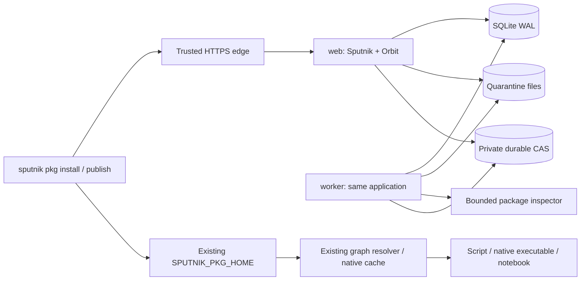
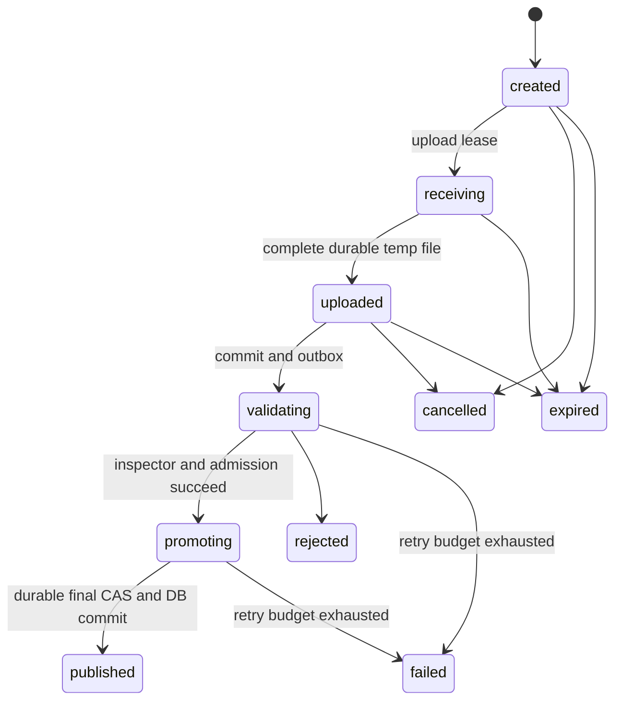

# Архитектура Sputnik Registry v1

Статус: спецификация для реализации. Актуализация: 2026-10-19.

## 1. Граница системы

Registry хранит metadata и неизменяемые `.sputnikpkg`, проверяет публикации
и управляет доступностью версий. Resolver и установка принадлежат toolchain.
Registry не исполняет modules, macros, native code, build hooks или package tests.

Первый deploy: один узел, один web process, один worker process, общий локальный
filesystem, SQLite WAL. Можно иметь несколько request tasks, но запись
сериализуется короткими SQLite transactions. Один migration process.
Network filesystem для SQLite/CAS не поддерживается этим профилем.

Auth, размерные/tenant quotas и download/publication statistics определены в
[ACCESS_AND_USAGE](ACCESS_AND_USAGE.md). Usage projection использует отдельный
local `usage.sqlite` и bounded spool; запись на каждый download не конкурирует
за metadata writer. Публикационные facts идут через уже существующий outbox.
Это тот же web/worker deployment, без нового network service.

## 2. Состав приложения

| Модуль | Ответственность |
|---|---|
| `registry.domain` | Reference, release, session state, ownership, policy results |
| `registry.application` | Publish/metadata use cases, transaction boundaries |
| `registry.web` | Orbit routes, exact JSON schemas, auth, status/cache mapping |
| `registry.persistence` | ORM models, repositories, SQL migrations, outbox |
| `registry.storage` | Quarantine, durable CAS, bounded downloads, reconciliation |
| `registry.validation` | Inspector, signatures, capability/native admission |
| `registry.worker` | Leases, validation, finalize, retries, cleanup |
| `registry.operations` | Config, health, metrics, backup/restore, operator commands |
| `registry.usage` | Business/transport ingestion, bounded spool, analytics projections и stats API |

Server — native executable: SQLite требует native leaves. Доменные объекты —
обычные Sputnik values/classes. Ports — документированный набор методов
адаптера, без предположения о новых возможностях языка. Controllers получают
application services и не выполняют SQL/строительство paths.

`orm` остаётся data layer. Pool привязывается при startup, use case
открывает transaction явно. Для reservation/lease/CAS update и migrations
разрешён bound SQL внутри persistence adapter через тот же pool. Lease
нельзя передавать в `task.spawn`; worker получает собственный checkout.
DB transaction не удерживается во время upload, hash, inspection или blob IO.
Request-wide pool integration не ставится на длинный upload route.

## 3. Identity и compatibility

Нормативные reference/layout находятся в [CLIENT](CLIENT.md).
Один canonical reference одинаков в manifest, dependency, API и lock.
Namespace стабилен при передаче ownership. После первой публикации reference
и namespace slug не перераспределяются. Неиспользованные reservations истекают.

Scoped `slowpilot/example` предоставляет только `slowpilot.*`, root также
с этим prefix. Unscoped grant содержит **явные** allowed module prefixes:
например `orbit-orm` → `orbit.integrations.orm`. Prefix сравнивается по границе
module segment. Root должен присутствовать в module table. Stdlib module ids
зарезервированы. Два providers одного module id в одном graph — ошибка resolver.

Protocol v1: release `(ref, version)` содержит platform variants. Immutable
artifact identity — `(ref, version, variant)`. Exact dependencies, одна
version/variant на graph, newest compatible stable без ranges. Формат artifact —
[`sputnik.pkg.v1`](PACKAGE_FORMAT.md), стандартный tar.gz с manifest/inventory
и отдельными files. Module поставляется как source (default) либо bytecode;
в одном package modes можно смешивать. Native extensions поставляют sources/headers
либо prebuilt shared libraries с зависимостями. Полный target/binding contract —
[NATIVE_ARTIFACTS](NATIVE_ARTIFACTS.md).
Server source не компилирует; client компилирует при install и кэширует вне archive.
Bytecode-only mode проверяет реальные profile/bytecode/ext ABI и target facts;
при несовместимости нет source fallback. Необъявленную compiler compatibility
сервер не выдумывает. Изменить existing variant bytes нельзя; новый platform
variant можно добавить к той же версии, если common release declarations
совпадают. Общие module names/common dependencies/capabilities immutable после
первого publish. Target/ABI/native metadata, representations и explicit exact
`[artifact.dependencies]` delta относятся к variant; selected graph объединяет
common и variant deps. Delta не меняет ранее опубликованный variant.

## 4. Publication lifecycle

`receiving` после разрыва возвращается в `created` через reclaim upload lease;
повтор PUT начинает файл с нуля. Cancel receiving fences lease и удаляет temp.
Cancel validating/promoting запрещён. `cancelled/expired/rejected/failed/published`
— terminal. Commit, принятый до deadline, не истекает посреди validation.

1. `CreateSession`: auth, quota, grant policy; transaction создаёт package
   reservation при необходимости, artifact reservation `(ref, version, variant)`,
   session, audit и
   idempotency result. Unique reservation исключает гонку.
2. `Upload`: CAS session revision + upload lease; поток в private temp file
   с hard limits. Сервер вычисляет полный SHA-256/size, выполняет fsync,
   затем transaction переводит `receiving -> uploaded`. Client digest не доверенный.
3. `Commit`: повторная auth; transaction `uploaded -> validating` + outbox.
   Ответ `202`, работу выполняет worker.
4. `Validate`: worker claim с deadline/generation; bounded inspector проверяет
   archive/inventory/source headers, все digests, bytecode, identity, prefixes,
   dependencies и policy; semantic source compilation остаётся client gate.
   Public profile проверяет detached publisher signature.
5. `Promote`: сохранить validation result и `promoting`; durable finalize CAS.
   Local storage: exclusive destination, проверка уже существующего digest,
   fsync файла и directory. Обычный overwrite rename не является no-replace.
6. `Publish`: **после finalize** короткая transaction повторно проверяет actor,
   token, grants, reservation generation, namespace/package status и lease;
   создаёт release/common dependencies при первом publish либо сверяет immutable
   common metadata существующего release; вставляет новый release artifact,
   заранее подготовленный signature receipt, audit/outbox, увеличивает index
   revision; grant потребляется первым release, session отмечается published.
   Receipt готовится вне transaction по immutable inspected values; final
   transaction подтверждает, что key/policy revisions не изменились.
7. Variant становится виден атомарно с final blob и metadata. Первый variant
   открывает release; последующие добавляются без замены старых. Session polling
   сообщает variant, digest и canonical artifact URL.

Filesystem и DB не образуют общую транзакцию. Порядок blob → DB допускает
orphan final blob после crash, но исключает published без durable blob.
CAS objects никогда не перезаписываются. Команды replace release нет.

## 5. Повторы, гонки и восстановление

| Ситуация | Поведение |
|---|---|
| Две сессии на один variant | Unique reservation; проигравшая получает `ARTIFACT_RESERVED` |
| Первые variants одной версии имеют разные declarations | Atomic common-metadata check; `RELEASE_METADATA_CONFLICT` |
| Повтор create с тем же key/body | Та же session; другой body — `IDEMPOTENCY_CONFLICT` |
| Повтор PUT после uploaded | Только те же bytes; другой upload конфликтует, файл не заменяется |
| Повтор commit | Текущее состояние; outbox key unique |
| Crash до finalize | Lease истекает, worker повторяет validation/promotion |
| Crash после finalize | Final blob проверяется, завершается DB publication |
| DB commit прошёл, ответ потерян | Poll/create replay возвращают published session |
| Старый worker ожил | Generation/fencing запрещает поздний DB publish |
| Права отозваны при validation | Финальный auth check отклоняет публикацию |
| Invalid artifact / TTL / cancel | Session сохраняется; reservation освобождается транзакционно |
| Storage unavailable | Bounded retry, затем terminal failed |

Release declarations становятся immutable при первом publish; identity variant
становится невозвратной **при его успешной публикации**. Другие variants той же
версии могут добавляться без изменения common declarations.
Новая попытка после terminal failure требует новой session/idempotency key.
Повтор старого key всегда возвращает прежний результат, не запускает работу.
Package reference tombstone после первой публикации сохраняется навсегда.

Jobs сначала внутри registry: DB-backed at-least-once, atomic claim,
lease 60 s, heartbeat 15 s, generation fencing, capped exponential backoff
1–300 s с jitter, максимум 10 попыток/24 h. Policy failures не retry.
Все deadlines сверяются по DB time; параметры конфигурируемы.

## 6. Read, yank и quarantine

Index содержит published active/yanked releases и доступные artifact variants;
quarantine release/variant скрыт. Download проверяет оба уровня.
Yank исключает release из выбора новой установки; pinned lock может получить
exact yanked digest. Новая установка yanked требует `--allow-yanked`.
Quarantine запрещает все **новые серверные скачивания**, включая pinned.
Уже установленные offline bytes отозвать нельзя.

GET index: ETag из revision, `max-age=30, must-revalidate`. Download v1:
availability check на каждый GET/HEAD, private CAS, `no-store`.
HTML/search не являются источником истины CLI. Нет публичного digest URL
для обхода quarantine. Уже начатый download при quarantine может завершиться.

## 7. Deployment и эксплуатация

TLS/Host/proxy/rate limits задаются trusted edge; Orbit слушает loopback/private
интерфейс. В private bootstrap accounts, grants и первые tokens создаёт local
operator command. Для public v1 R8 добавляет CLI login через GitHub Device Flow,
self-service account/personal namespace signup и JSON API tokens/publisher keys.
`registration=closed|open` независимо от read/trust profiles; API остаётся bearer.
Frontend, browser sessions, passwords и organizations не входят в v1. Детали —
[ACCESS_AND_USAGE](ACCESS_AND_USAGE.md).
Bearer token даёт пересечение scopes и текущих account/package/namespace прав;
terminal publish повторяет проверку прав.

Readiness проверяет schema version, DB, writable quarantine/CAS, disk budget,
key availability public profile и worker heartbeat. При неработающем validator
приём uploads блокируется, чтобы не накапливать bytes без границ.
Shutdown прекращает uploads/jobs, завершает либо fences активную работу.
Liveness не зависит от внешних сервисов. [SECURITY](SECURITY.md) задаёт limits,
backup и ключи. [DATA_MODEL](DATA_MODEL.md) задаёт constraints.

## 8. Масштабирование

PostgreSQL/ORM adapter и S3 реализуют те же repository/blob contracts с parity
suite. Bucket private; finalize проверяет size/digest/durability до DB publish.
Signed URLs допустимы в отдельном профиле с явным quarantine propagation window.
Default v1 этого не использует.

Перенос SQLite → PostgreSQL: write maintenance window, consistent export,
copy/verify blobs, import/constraints, переключение. Online dual write и
безостановочный cutover не обещаются. Redis, broker, search и общий jobs/blobstore
package появляются по реальной потребности.
