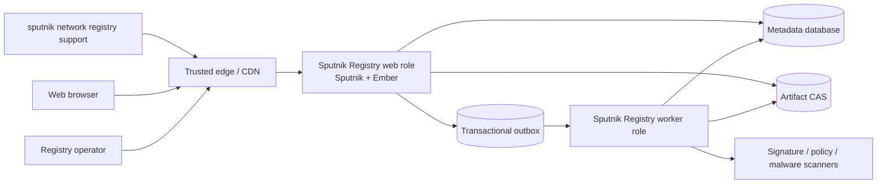
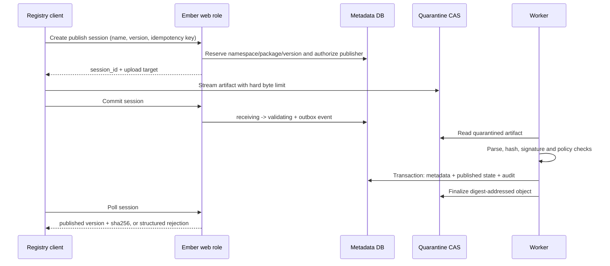

# Архитектура Sputnik Registry

Статус: proposed, архитектурный baseline без реализации.  
Дата: 2026-07-26.

## 1. Назначение

Sputnik Registry хранит метаданные библиотек Sputnik и неизменяемые
`.sputnikpkg`-артефакты, управляет правами публикации и предоставляет стабильный
машинный индекс для будущего сетевого клиента `sputnik`.

Главные свойства системы:

1. опубликованную пару `package reference + version` нельзя заменить;
2. байты артефакта идентифицируются вычисленным сервером SHA-256;
3. сервер никогда не исполняет код из пакета;
4. метаданные индекса публикуются только после полной обязательной проверки;
5. yank сохраняет историю и доступ к байтам, но исключает версию из обычного
   выбора;
6. критические изменения владельцев, токенов, релизов и карантина попадают в
   append-only аудит;
7. публичный read path не зависит от web-сессии и пригоден для CDN-кэширования;
8. обычный package reference имеет вид `publisher/package_name`; короткие
   unscoped имена выдаются только по operator grant.

## 2. Контекст и границы



Trusted edge завершает TLS, удаляет клиентские forwarding headers, задаёт
канонические `X-Forwarded-*`, ограничивает размер/скорость запросов и может
кэшировать публичные GET/HEAD. Ember слушает только приватный интерфейс в
соответствии со своим production contract.

Внешними системами считаются:

- `sputnik` с будущей поддержкой сетевого registry protocol;
- PostgreSQL или SQLite;
- локальная файловая система либо S3-совместимый blob store;
- OIDC provider для публичного production-профиля;
- malware scanner и OTLP collector в public production-профиле.

## 3. Package references и namespaces

### 3.1 Scoped reference по умолчанию

Канонический идентификатор обычного пакета состоит из двух независимо
валидируемых компонентов:

```text
publisher/package_name
```

`publisher` — стабильный namespace account или organization. Это не имя
текущего maintainer: ownership можно передать без изменения imports,
dependency declarations и lockfiles.

Один и тот же reference используется во всех местах:

- `[package].name` внутри `sputnik.toml` и `.sputnikpkg`;
- ключ dependency;
- publish request;
- install request;
- metadata index;
- `sputnik.lock` вместе с registry origin, version и artifact digest.

Registry identity и module identity при этом различаются. Scoped reference
записывается в `[package].name`, а `root_module` и `[[modules]].name` остаются
обычными Sputnik module names без `/`. Чтобы scoped registry не оставлял
отдельную возможность захватывать короткие import names, admission policy v1
требует namespace prefix:

- `slowpilot/json` экспортирует root `slowpilot.json` и только
  `slowpilot.*` modules;
- curated unscoped `json` может экспортировать `json` и `json.*`.

Установка выполняется по registry reference, импорт — по объявленному module
name. `sputnik` проверяет prefix policy и запрещает две dependencies,
предоставляющие один logical module id.

Будущий сетевой режим `sputnik` принимает scoped reference, например
`slowpilot/json`. Точный CLI verb ещё должен быть согласован в toolchain; эта
архитектура фиксирует identity, а не придумывает существующую команду.

Текущий `safe_registry_component` Sputnik принимает только alphanumeric, `.`,
`_`, `-` и не допускает `/`. Toolchain должен разбирать reference до
filesystem mapping: либо ровно один separator для scoped пакета, либо ни
одного для разрешённого unscoped пакета. Каждый component затем проверяется
отдельно. Raw reference никогда не используется как blob path.

### 3.2 Curated unscoped reference

Reference `package_name` без publisher разрешён только когда:

1. оператор выдал subject право публиковать unscoped packages;
2. оператор зарезервировал за ним конкретное короткое имя;
3. publish artifact содержит именно это unscoped имя.

Глобального права захватывать любые короткие имена недостаточно. Reservation
конкретного имени сохраняет curated policy и аудит решения.

После первой публикации scoped или unscoped reference не перераспределяется
другому проекту. Заброшенный проект помечается archived, его версии можно
yank/quarantine, а metadata может рекомендовать replacement. Переиспользование
имени создало бы dependency takeover.

Автоматическое promotion `publisher/name -> name` не входит в protocol v1.
Если позже появятся aliases, resolver обязан вернуть исходный canonical
scoped reference и записать его в lockfile.

## 4. Архитектурный стиль

Выбран модульный монолит с ports-and-adapters границами.

Внутри одного исходного проекта существуют две runtime-роли:

- `web`: Ember routes, authentication, read API, orchestration публикации;
- `worker`: validation jobs, outbox delivery, cleanup, reconciliation и
  периодические проверки целостности.

Роли разделяют доменную модель, use cases и repository interfaces. Это
сохраняет одну транзакционную границу и не вводит преждевременные сетевые
вызовы между внутренними модулями. Горизонтальное масштабирование достигается
несколькими stateless web/worker экземплярами после перехода на PostgreSQL и
object storage.

## 5. Логические слои

### 5.1 Delivery

`Registry::Web` содержит только Ember-специфические объекты:

- маршруты и strong parameter schemas;
- bearer-token и browser-session middleware;
- преобразование доменных результатов в HTTP status/error envelope;
- ETag, cache-control, range/download policy;
- health, readiness и metrics endpoints.

Контроллеры не выполняют SQL, не строят blob paths и не принимают решений о
правах собственности самостоятельно.

### 5.2 Application

Use cases образуют явную транзакционную границу:

- `StartPublishSession`;
- `AttachArtifact`;
- `CommitPublication`;
- `GetPackageIndex`;
- `YankVersion` / `UnyankVersion`;
- `AddOwner` / `RemoveOwner`;
- `CreateToken` / `RevokeToken`;
- `QuarantineVersion`;
- `ReconcilePublication`.
- `GrantUnscopedName` / `RevokeUnusedUnscopedGrant`.

Use case координирует доменные правила, repositories, blob store и outbox.
Он не зависит от Ember, SQLite, PostgreSQL или S3.

### 5.3 Domain

Доменные модули:

| Модуль | Ответственность |
|---|---|
| Identity | accounts, organizations, memberships, API tokens и scopes |
| Namespaces | publisher namespaces и curated unscoped-name grants |
| Packages | canonical reference, ownership, metadata и lifecycle пакета |
| Releases | publish session, version identity, yank и quarantine |
| Artifacts | digest, size, media type, validation result и storage key |
| Policy | лимиты, запрещённые имена, native/capability policy |
| Discovery | стабильная модель index/search без storage деталей |
| Audit | неизменяемые security и administrative events |

Домен знает интерфейсы `Clock`, `IdGenerator`, `PackageInspector`,
`BlobStore`, `Repositories` и `EventSink`, но не их реализации.

### 5.4 Persistence

Repositories реализуются через `sputnik-orm`. Модели ORM остаются адаптером,
а не доменными сущностями: наружу возвращаются доменные значения и
структурированные ошибки.

Для сложных выборок индекса допускаются выделенные query repositories. Это
не нарушает требование использовать `sputnik-orm`: запись и базовые модели
остаются в ORM, а read-модель получает отдельный, тестируемый адаптер вместо
протекания SQL в контроллеры.

### 5.5 Artifact storage

`BlobStore` предоставляет операции:

- создать quarantine object;
- дописать поток с жёстким лимитом;
- завершить объект и вернуть вычисленный digest/size;
- атомарно сделать объект доступным по digest;
- открыть bounded stream для скачивания;
- проверить наличие и удалить только orphan/quarantine объект;
- в production вернуть короткоживущий signed download URL.

Ключ объекта выводится только из SHA-256, например
`sha256/ab/cd/<digest>.sputnikpkg`. Имя пакета, версия и пользовательское имя
файла никогда не участвуют в физическом пути.

Bootstrap adapter использует временный файл и rename в пределах одного
filesystem. Production adapter использует quarantine key, server-side copy
или finalize marker в S3-совместимом хранилище.

### 5.6 Package inspection

`PackageInspector` — отдельный security boundary. Он обязан:

- ограничить размер файла, число записей, размер manifest/lockfile и
  количество модулей/native blobs;
- разобрать формат `.sputnikpkg`;
- пересчитать manifest, lockfile, module и native blob digests;
- проверить artifact signature согласно registry policy;
- вернуть нормализованные package reference, версию, dependencies, modules,
  capabilities и native metadata;
- не загружать пакет в runtime и не вызывать его module initialization;
- выдавать стабильные коды ошибок без включения секретов или сырых байтов.

Текущий C++ package API Sputnik не может быть незаметно вызван приложением.
До появления пакета `sputnik-package` publish path считается заблокированным;
shell-out в `sputnik` не является production-решением.

## 6. Поток публикации

Публикация двухфазная, чтобы одинаково работать с локальным диском и прямой
загрузкой в object storage.



Для bootstrap-профиля upload target остаётся endpoint сервера, который
streaming-режимом пишет в локальный quarantine. Для production это может быть
короткоживущий signed upload URL. Протокол и состояния не меняются.

### 6.1 Состояния publish session

`created -> receiving -> uploaded -> validating -> published`

Терминальные альтернативы:

- `rejected`: содержимое или политика не прошли проверку;
- `expired`: commit не выполнен до deadline;
- `failed`: временная инфраструктурная ошибка исчерпала retry budget.

`failed` можно безопасно повторить с тем же idempotency key. `rejected`
требует новой сессии и другого артефакта.

### 6.2 Commit без распределённой транзакции

База и blob store не образуют одну ACID-транзакцию. Поэтому:

1. quarantine object никогда не виден через public download;
2. версия становится `published` только при наличии final blob или
   подтверждённой операции finalize;
3. database transaction одновременно записывает release metadata, audit и
   outbox;
4. reconciler исправляет `validating/failed` сессии и удаляет orphan
   quarantine objects после retention window;
5. public index выбирает только `published` и не `quarantined` записи.

## 7. Read path

Машинный индекс отделён от HTML-сайта.

- package detail и index response строятся из нормализованной read-модели;
- ответы имеют schema version, ETag и конечный `Cache-Control`;
- yank/quarantine меняет ETag;
- артефакт получает immutable cache headers, потому что URL содержит digest
  либо редиректит на digest-addressed object;
- клиент всегда получает ожидаемый SHA-256 до скачивания;
- index, install и lockfile всегда возвращают canonical scoped/unscoped
  package reference без неявного сокращения;
- обычный resolver не выбирает yanked version, но lockfile может запросить её
  явно по имени, версии и digest, пока версия не quarantined;
- quarantine отключает новые скачивания и resolver visibility, сохраняя
  административное evidence.

## 8. Идентичность и авторизация

### 8.1 API tokens

Публикация использует opaque bearer token не короче 256 бит, созданный через
`SecureRandom`. В базе хранится только SHA-256 токена, его короткий display
prefix, scopes, subject, timestamps и необязательный expiry.

Минимальные scopes:

- `package:read`;
- `package:publish:<canonical-ref>`;
- `package:yank:<canonical-ref>`;
- `package:owners:<canonical-ref>`;
- `namespace:create-package:<publisher>`;
- `admin:grant-unscoped`;
- `admin:quarantine`;
- `admin:accounts`.

Token выводится пользователю один раз. Ротация создаёт новый token, после чего
старый явно отзывается.

### 8.2 Namespaces

Каждый account получает personal namespace только после проверки canonical
handle policy. Organization namespace управляется membership roles. Namespace
slug становится неизменяемым после первой публичной публикации.

Роли namespace:

- `owner`: memberships и namespace policy;
- `maintainer`: создание scoped packages;
- `viewer`: приватный namespace в будущем.

Unscoped grant не является свойством namespace по умолчанию. Это отдельная
operator-controlled запись с subject, конкретным коротким именем, причиной,
сроком до первой публикации и audit trail. Неиспользованный grant можно
отозвать; опубликованное unscoped имя не перераспределяется.

### 8.3 Package ownership

У пакета всегда есть хотя бы один owner. Роли:

- `owner`: владельцы, токены, yank и publish;
- `publisher`: publish и yank;
- `viewer`: приватные пакеты в будущем.

Удаление последнего owner запрещено. Передача ownership и добавление owner
создают audit event. Scoped package можно создать только внутри доступного
subject namespace. Unscoped package требует отдельного grant конкретного
имени. Спорные имена решаются оператором, а не автоматической перезаписью
владельца.

## 9. Модель доверия и безопасности

Основные угрозы и ответы:

| Угроза | Контроль |
|---|---|
| Подмена опубликованной версии | unique `(package_id, version)`, immutable blob, server-computed digest |
| Path traversal | storage key строится только из валидированного digest |
| Zip/archive bomb или parser DoS | `.sputnikpkg` не распаковывается; все счётчики/размеры ограничены |
| Выполнение вредоносного пакета | inspector только парсит и проверяет, runtime load запрещён |
| Кража publish token | token хранится только как digest, scopes минимальны, аудит и revoke |
| Confused deputy | URI package reference/version обязаны совпасть с артефактом |
| Global name squatting | scoped references по умолчанию, audited unscoped grants |
| Import-name squatting | modules scoped package обязаны иметь `publisher.` prefix |
| Abandoned-name takeover | опубликованные references не перераспределяются |
| Race двух публикаций | database unique constraint и idempotency key |
| Supply-chain подмена | Ed25519 из stdlib/toolchain, keyring gate, SHA-256 в index/lockfile |
| SSRF | artifact validation не делает исходящих запросов; URL metadata не допускается |
| Resource exhaustion | edge + Ember body/concurrency/time limits, quotas на subject/package |
| Удаление evidence | yank/quarantine вместо delete, append-only audit |

Raw publish upload использует отдельный media type, а не multipart. Лимиты
transport, staging и inspector должны совпадать. Любое повышение package size
limit требует нагрузочного и disk-pressure теста.

Native extensions получают отдельную policy:

- сервер проверяет declared metadata и digests, но не компилирует native code;
- public launch требует malware scanner;
- index явно сообщает наличие native blobs, ABI и target triples;
- registry может запретить native extensions для конкретного tenant или до
  завершения supply-chain этапа.

## 10. Наблюдаемость и эксплуатация

Ember telemetry является входной границей:

- structured access/error/lifecycle logs без path, query, authorization и
  artifact bytes;
- bounded metrics с labels только по route template, method, status class,
  outcome и job kind;
- W3C trace context принимается только от trusted edge;
- liveness отражает способность процесса исполняться;
- readiness web-роли требует database и обязательный blob store;
- readiness worker-роли требует database, blob store и обязательные scanners.

Доменные метрики:

- publish sessions по состояниям;
- validation duration и rejection reason class;
- bytes uploaded/downloaded;
- outbox lag, retry и dead-letter count;
- orphan quarantine objects;
- blob/database integrity mismatches;
- token authentication failures и rate-limit rejections.

Логи никогда не содержат bearer tokens, package bytes, cookies, полные
dependency manifests или причины внутренней криптографической ошибки.

Начальные SLO после появления production-профиля:

- read API availability: 99.9% за 30 дней;
- publish API availability: 99.5% за 30 дней;
- p95 package-index latency на edge miss: менее 300 мс;
- 99% обязательных validation jobs: менее 60 секунд для артефакта в лимите;
- RPO metadata: не более 5 минут, RTO: не более 60 минут;
- потеря уже подтверждённого immutable blob: 0.

SLO становятся release gate только после измеримого baseline; до этого это
целевые бюджеты, а не заявленная гарантия.

## 11. Масштабирование

### Bootstrap

- один web process и один worker process;
- общий локальный persistent volume;
- SQLite WAL через `sqlite3-sputnik`;
- local CAS;
- регулярный snapshot базы и blob inventory;
- публикация временно останавливается на время несовместимой миграции.

Bootstrap предназначен для разработки, частного registry и canary. Он не
объявляется публично highly available.

### Production

- несколько stateless web и worker replicas;
- PostgreSQL как источник истины metadata/outbox;
- S3-compatible storage с versioning, lifecycle и cross-zone durability;
- CDN для public index и artifacts;
- worker lease через `FOR UPDATE SKIP LOCKED` или эквивалент пакета jobs;
- rolling expand/migrate/contract schema changes;
- backup/restore rehearsal и периодический inventory reconciliation.

Переход не меняет domain/use-case API: заменяются persistence и blob adapters.

## 12. Проектные границы

Планируемая структура исходного проекта после начала реализации:

```text
src/registry/domain/          чистые доменные значения и правила
src/registry/application/     use cases и ports
src/registry/web/             Ember routes/controllers/middleware
src/registry/persistence/     sputnik-orm models и repositories
src/registry/storage/         local/S3 BlobStore adapters
src/registry/jobs/            outbox handlers и reconciler
src/registry/telemetry/       domain metrics, logs и traces
test/                         domain, contract, integration, security
deploy/                       edge, systemd/Kubernetes examples
docs/                         контракты, threat model, runbook и ADR
```

Это карта ответственности, а не заготовка кода.

## 13. Release gates

Реализация может называться production-ready только когда:

1. опубликован protocol v1 и `sputnik` поддерживает scoped publish/install;
2. package parser/verifier доступен из Sputnik и прошёл hostile corpus/fuzzing;
3. Ed25519 добавлен в Sputnik stdlib/toolchain, а реальные подписи и key
   rotation заменили dev signature;
4. PostgreSQL и object storage adapters прошли failure/retry tests;
5. schema migrations поддерживают rolling upgrade и rollback policy;
6. threat model и security review не имеют открытых critical/high;
7. backup/restore и blob reconciliation отрепетированы;
8. edge/proxy deployment прошёл canary;
9. Ember и registry выдержали 72-часовой mixed-load soak;
10. опубликованы SLO baseline, on-call runbook и incident procedures.
