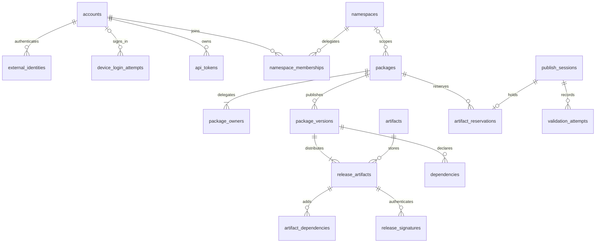

# Модель данных v1

Статус: спецификация для реализации, DDL ещё нет. Актуализация: 2026-10-20.
В MVP accounts, без organizations/private packages. Internal IDs opaque;
DB timestamps UTC. Metadata uses bound parameters, не SQL interpolation.

## 1. Связи

## 2. Таблицы и ограничения

| Таблица | Основные поля и constraints |
|---|---|
| `schema_migrations` | version PK, checksum, applied_at, tool revision |
| `accounts` | id, unique canonical handle, status active/suspended/closed; handle не является external identity |
| `external_identities` | id/account FK, provider, subject, unique(provider, subject), unique(account, provider), display login, created/last_login_at; GitHub subject = numeric user id |
| `device_login_attempts` | id, unique login-secret digest, provider, web boot id, state pending/verified/completed/denied/expired/failed/cancelled, expected/resolved account nullable, verified subject/time, expiry, interval/next_poll_at, poll lease/generation, completion key/request hash, issued token FK, consumed_at; provider device code только в bounded web memory |
| `namespaces` | id, unique immutable canonical slug, status, first_published_at, policy_revision |
| `namespace_memberships` | namespace/account FK, role owner/maintainer, unique pair |
| `unscoped_name_grants` | id, unique name, account, state reserved/consumed/revoked/expired, expires_at, allowed module prefixes, operator/reason, resulting package |
| `api_tokens` | id/account, unique digest SHA-256, display prefix, label, scopes, expiry/revoked_at, bounded/coalesced last_used_at |
| `publisher_keys` | id/account, unique key_id, Ed25519 public key, created/revoked_at, allowed refs/namespaces |
| `packages` | id, namespace nullable, local name, unique canonical_ref, status reserved/active/archived/suspended, ever_published, allowed module prefixes, policy_revision, index_revision |
| `package_owners` | package/account, role owner/publisher, granted_by/at, unique pair |
| `artifact_reservations` | package/version/variant unique PK, session unique FK, generation, acquired_at; одна активная reservation на variant |
| `publish_sessions` | id, actor/token, package/version/variant, limit_profile, expected/actual digest/size, state/revision, temp key, upload lease/fence, deadline, terminal_at, bounded error code, publisher signature |
| `validation_attempts` | session, attempt, policy version, worker/generation, result code, started/ended_at, resource usage; unique session/attempt |
| `artifacts` | id, unique SHA-256, size, format, CAS key, durable_at, integrity status, created_at |
| `package_versions` | id, package/version unique, common metadata/hash, first publish actor/time, yanked flag/reason/time, quarantined flag/reason/time, revision |
| `release_artifacts` | id, release/variant unique, artifact FK, target/ABI/import/representation metadata, native_mode, inventory digest/expanded size, policy version, publish actor/time, quarantine status/reason |
| `dependencies` | release/ordinal, ref, exact version, unique release/ref; common declarations, без выбранного artifact digest |
| `artifact_dependencies` | release_artifact/scope/ordinal, ref, exact version, unique artifact/scope/ref; scope runtime/build, declared variant delta, applicable graph без conflicting exact versions/providers |
| `release_signatures` | release_artifact/role/key_id, algorithm, public key snapshot, signature, signed_at для receipt, immutable payload version; unique release_artifact/role |
| `audit_events` | id/time/type, actor/target, request id, bounded structured facts; append-only |
| `outbox_events` | id/type/aggregate/revision, payload, available_at, lease owner/deadline/generation, attempts, processed/dead_letter_at; unique type/aggregate/revision |
| `idempotency_records` | account/action/target/key_hash unique, typed request_hash, resource/result reference, status, expires_at; без secrets |
| `admission_grants` | subject account/namespace, native/profile grant, revision, issuer/reason/expiry; operator-managed |
| `quota_reservations` | session/attempt/generation/resource unique, owner/profile, pending/temp/scratch/traffic credits, state; fenced cleanup |
| `quota_usage` | owner/profile/resource/window unique, durable charged/reserved values; logical published storage и rolling traffic |

В DDL: NOT NULL, FK, CHECK enum/size/nonnegative/revision; PRAGMA foreign_keys
на каждой connection. Canonical_ref namespace/name agreement проверяется общим
constructor и application invariant, а не дублирующим несовместимым SQL regex.
Account/identity/personal namespace/owner membership/первый API token создаются
одной transaction вместе с consumption verified device attempt. Unique identity,
handle и namespace constraints сериализуют concurrent signup. Restart обрывает
pending device attempts: provider secrets не хранятся в DB. Browser sessions,
пароли и browser OAuth state не входят в schema v1.
Release common metadata содержит root/module names, exact dependencies и
required capabilities; immutable hash сверяется при добавлении variants.
Release artifact metadata содержит representation (source/bytecode), member
paths/digests, target/native kind/ABI/imports и inventory digest/expanded size. Artifact SHA-256 по compressed bytes, format
сохраняется явно. Server не хранит client compilation outputs в CAS.
Дополняется bundle profile, native requirements/providers и component inventory
summary по [NATIVE_BUNDLES](NATIVE_BUNDLES.md). Common metadata также фиксирует
package kind: native-only packages имеют logical native exports, пустой module
set и отсутствующий root; library packages сохраняют modules/root invariants.
Вложенные providers не создают фиктивных registry releases или runtime edges
к packages, чьи bytes уже включены. Build-only edges отделены от runtime.
Module prefixes хранятся нормализованным ordered набором; поиск modules может
получить отдельную таблицу позже. JSON metadata имеет schema/version и size cap.

CAS artifacts могут иметь несколько references. Release имеет несколько
release_artifacts, а каждый variant ссылается на один CAS object.
Reservation отдельна от release/artifact rows; первый successful variant
создаёт release. Новые variants добавляются, common metadata не меняется.
Unique `(release, variant)` и его digest не переиспользуются. Rows published
release/artifact не удаляются. Initial variants cap — 32.
Yank и quarantine — независимые flags; снятие quarantine сохраняет прежний yank.

## 3. Транзакции

Отдельный `usage.sqlite` содержит `usage_seen_events` (unique server event ID),
`artifact_usage_daily`, lifetime rollups и ingestion watermarks/gaps. Canonical
artifact identities копируются как validated values, без cross-DB foreign keys.
Download rows не обновляют metadata DB. Business audit receipts/outbox создаются
в metadata transaction, projection/dedup — в одной analytics transaction, ack
outbox — после неё. Replay идемпотентен; authoritative quotas не берутся из
analytics. Полная семантика/retention — [ACCESS_AND_USAGE](ACCESS_AND_USAGE.md).

### Создание session

`BEGIN IMMEDIATE` (SQLite): проверить token/current rights, existing release
availability/variant uniqueness, active artifact reservation, profile quota и idempotency. Создать reserved package при первом
publish, первого owner, session/reservation, audit/idempotency. Внешнее IO отсутствует.
Expired reservation освобождается только после fencing/terminal transition
старой session в той же transaction, не по одному client-side clock comparison.

### Upload и commit

Claim upload выполняется conditional update по state/revision/generation.
Bytes пишутся вне transaction. Upload finalize проверяет ту же generation.
Commit transaction обновляет uploaded → validating и вставляет unique outbox.
Stale upload completion после cancel/lease reclaim не может вернуть uploaded.

### Worker publish

После durable CAS finalize transaction сверяет reservation/session/worker fence,
все auth/key/policy revisions, artifact digest/size, отсутствие release variant.
Создаёт release/dependencies при первом variant либо сверяет frozen common
metadata и availability. Conflict declarations → rejection. Вставляет/находит
CAS artifact, создаёт release_artifact/artifact_dependencies/signatures; session → published; снимает
variant reservation. Grant consumed первым release; package active/ever_published;
index_revision++; audit/outbox. Все изменения commit либо rollback вместе.
При policy revision change работа возвращается на validation, не публикует старый verdict.

### Terminal failure

Одна transaction: terminal state/error, reservation removal только с matching
session/generation, audit, cleanup job. Неуспешная session не занимает variant
навсегда и не удаляет release/другие published variants. Сама session/idempotency история сохраняется по retention.
Empty never-published reserved package можно удалить после 7 days без sessions;
consumed grant и ever_published identity не удаляются/не переиспользуются.

### Owners/yank/quarantine

Последний active owner проверяется под той же write transaction, что и удаление;
account suspension тоже не оставляет active package без ответственного owner:
оператор назначает replacement либо suspends package. Package ownership не даёт
права сменить namespace/ref. Namespace owner не получает неявно право удалить
последнего package owner; operator overrides отдельны и аудитируются.
Release yank/quarantine или artifact quarantine меняют index revision и audit
в той же transaction; artifact availability проверяется вместе с release status. No-op не увеличивает revision.

## 4. Leases, indexes и SQLite

SQLite bootstrap: WAL, foreign_keys on, synchronous FULL, busy_timeout 2 s,
pool max 4 на web и 2 на worker; finite checkout 2 s. Values — начальные
defaults, подлежат load gate. Migration runner — единственный writer на startup;
web не начинает работу при несоответствии schema.

Worker claim: короткий conditional UPDATE + generation increment + affected-row
check в transaction; не `SELECT`, затем безусловный update. Все handlers
at-least-once и идемпотентны. Lease expiration не разрешает stale worker commit.
PostgreSQL adapter позднее использует row locks, сохраняя те же invariants.

Индексы: unique namespace/ref/package-version/release-variant/token digest;
artifact target/selectors и source ABI providers; reservation PK;
sessions по state/deadline и actor; outbox по processed/available_at/lease_deadline;
audit по target/time и actor/time; versions по package и publish time;
dependencies по ref/version для reverse lookup. Initial search по canonical_ref
с prefix filter и keyset pagination; FTS/description ranking после metadata extension.

## 5. Миграции и retention

Checksummed ordered SQL files, отдельный runner внутри registry. Unknown/mismatched
checksum/schema — startup failure. Migration lock, backup перед destructive changes,
DDL применяется транзакционно, где возможно. No auto migration каждым web replica.
Expand/contract перед rolling deploy; data downgrade только через tested restore,
а не обещание универсальных down migrations.

Terminal session и validation metadata: 30 days; private failed uploads: 24 h;
never-referenced final blobs: минимум 7 days. GC требует отсутствия references
из releases, активных sessions/jobs и backup holds; online GC только quarantine
в MVP, final-CAS GC — отдельное operator maintenance действие после reconciliation.
Audit и опубликованные release identities сохраняются; tokens очищаются без
утраты audit identity. Exact retention персональных данных определяется operator
policy перед public launch. Appendix не вводит legal deletion в immutable blobs.
