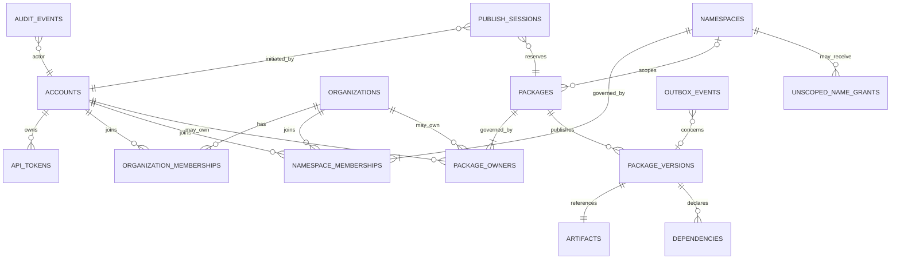

# Модель данных Sputnik Registry

Статус: логическая модель. Конкретный DDL и ORM-модели появятся на этапе
реализации.  
Дата: 2026-07-26.

## 1. Связи

Organizations закладываются в logical model, но могут быть отложены после
MVP. До этого personal namespace и `package_owners` ссылаются только на
account.

## 2. Основные сущности

### `accounts`

- immutable internal id;
- public handle и canonical handle;
- status: `active`, `suspended`, `closed`;
- identity-provider subject;
- created/updated timestamps.

Email и display profile не используются как authorization identity.

### `namespaces`

- id;
- unique canonical slug — `publisher` из `publisher/package_name`;
- display name;
- status: `active`, `suspended`, `closed`;
- created timestamp;
- `publications_count`.

Namespace принадлежит account или organization через membership, а не
зашивается в строку текущего owner. Slug нельзя менять после первой публичной
публикации.

### `namespace_memberships`

- namespace id;
- subject kind/id: account или organization;
- role: `owner`, `maintainer`, `viewer`;
- granted_by и granted_at.

Namespace `maintainer` может создавать новые scoped packages, но управление
membership остаётся у `owner`.

### `unscoped_name_grants`

- id;
- exact canonical package name;
- subject или namespace, которому разрешена публикация;
- state: `reserved`, `consumed`, `revoked`, `expired`;
- operator actor, reason, created/expires/consumed timestamps;
- resulting package id после публикации.

Unique active grant на canonical short name. Опубликованное имя не
освобождается при revoke account или archive проекта.

### `api_tokens`

- id и account id;
- token digest SHA-256, уникальный;
- display prefix;
- canonical scopes;
- optional package restriction;
- created, expires, last_used и revoked timestamps.

Plaintext token не хранится.

### `packages`

- id;
- nullable namespace id: `null` только для curated unscoped package;
- local package name;
- unique canonical reference: `publisher/package_name` либо `package_name`;
- status: `active`, `reserved`, `archived`, `quarantined`;
- summary/homepage/repository metadata после расширения manifest;
- created/updated timestamps;
- monotonically increasing `index_revision` для ETag/cache invalidation.

Publisher и local package name канонизируются отдельно. Canonicalization
должна быть одинаковой в compiler, `sputnik` и server. Пока этот контракт не
принят, public name registration не открывается.

### `package_owners`

- package id;
- subject kind/id: account или organization;
- role: `owner`, `publisher`, `viewer`;
- granted_by и granted_at.

Unique key: `(package_id, subject_kind, subject_id)`. Constraint или
transactional invariant запрещает удаление последнего active owner.
Namespace membership разрешает первичное создание, а package ownership —
дальнейшее делегирование конкретного проекта.

### `package_versions`

- id и package id;
- exact canonical version string и необязательное parsed SemVer value;
- publish state: `reserved`, `validating`, `published`, `rejected`;
- availability: `active`, `yanked`, `quarantined`;
- artifact id;
- publish actor и timestamp;
- yank/quarantine timestamps и reason codes;
- normalized manifest snapshot;
- Sputnik/package-format/ABI metadata;
- optimistic revision.

Главный unique key: `(package_id, canonical_version)`. Он создаётся на этапе
reservation, а не в конце проверки, поэтому две гоняющиеся публикации не
могут обе победить. До принятия SemVer `canonical_version` может быть exact
opaque version с более строгой registry-safe grammar; range resolution в
таком профиле отсутствует.

### `artifacts`

- id;
- unique SHA-256;
- byte size;
- media type и format version;
- storage key, образованный из digest;
- signature algorithm/key id/status;
- validation policy version;
- scanner state;
- created timestamp.

Одинаковые байты могут физически дедуплицироваться, но разные
`package_versions` никогда не меняют artifact reference после публикации.

### `dependencies`

- package version id;
- stable ordinal;
- declared package reference;
- canonical dependency reference;
- raw constraint string;
- parsed constraint representation/version;
- optional/resolution flags после расширения package format.

Сервер индексирует declarations, но не сохраняет «выбранную» dependency
версию: resolution выполняет client и фиксирует в `sputnik.lock`.

### `publish_sessions`

- id;
- actor, package, requested version;
- state и state revision;
- idempotency key hash;
- quarantine object key;
- expected/actual digest и size;
- retry count, deadline и last error class;
- created/updated timestamps.

Session имеет finite TTL. Переходы состояния выполняются compare-and-set или
под row lock.

### `audit_events`

Append-only:

- event id/time/type;
- actor kind/id;
- target kind/id;
- request id и trace id;
- bounded structured facts;
- previous/event hash для tamper-evident export на production этапе.

В audit нельзя записывать token, cookie, artifact body, полный manifest или
неочищенное exception message.

### `outbox_events`

- id, event type, aggregate id/revision;
- bounded payload;
- available_at, lease owner/deadline;
- attempt count;
- processed/dead-letter timestamps.

Outbox вставляется в одной database transaction с доменным изменением.
Доставка at-least-once, поэтому каждый handler идемпотентен.

### `idempotency_records`

- subject id;
- endpoint/action;
- key hash;
- canonical request hash;
- response status/body reference;
- expiry.

Unique key: `(subject_id, action, key_hash)`.

## 3. Инварианты

1. У active package есть хотя бы один owner.
2. У `published` version есть полностью проверенный final artifact.
3. Artifact digest и size после публикации не меняются.
4. Package reference содержит либо ровно два scoped components, либо один
   operator-approved unscoped component.
5. Namespace slug не меняется после первой публичной публикации.
6. Опубликованный scoped/unscoped package reference не перераспределяется.
7. `(package, canonical_version)` никогда не переиспользуется, даже после
   yank, quarantine или account closure.
8. `rejected` reservation освобождается только явной retention policy; имя
   опубликованной версии не становится доступным другому artifact случайно.
9. Yank не изменяет bytes и не удаляет audit.
10. Quarantine имеет приоритет над yank/unyank и download.
11. Dependency edges принадлежат immutable version metadata.
12. Каждое security-sensitive изменение создаёт audit event в той же
   transaction.
13. Каждая требующая background work запись создаёт outbox event в той же
    transaction.

## 4. Индексы read path

Минимально необходимы:

- unique namespace slug;
- unique canonical package reference;
- unique active unscoped-name grant;
- unique package/version;
- package versions по `(package_id, availability, published_at)`;
- optional semantic version sort key после включения SemVer profile;
- dependencies по canonical dependency reference;
- token digest;
- publish sessions по state/deadline;
- outbox по `(processed_at, available_at, lease_deadline)`;
- audit по target и descending time;
- search key по normalized package name.

Полнотекстовый search engine не нужен для MVP. Сначала используются
детерминированный поиск по `publisher/package_name`, local-name prefix и
ограниченный metadata search в основной базе.

## 5. Миграции

Schema changes следуют expand/migrate/contract:

1. additive schema, совместимая со старым приложением;
2. backfill через bounded resumable job;
3. dual-read/dual-write только на ограниченный переходный период;
4. переключение read path;
5. удаление старого поля отдельным release после доказанного rollback window.

Каждая миграция имеет version, checksum, transaction policy, timeout,
forward/rollback notes и проверку ожидаемой schema. На первом этапе runner и
SQL migrations могут жить внутри Sputnik Registry; выделять `sputnik-migrate` в
отдельный reusable package до появления второго потребителя не требуется.
