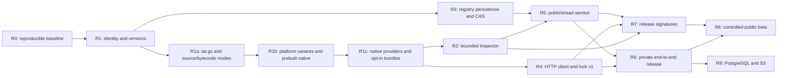

# План реализации Sputnik Registry v1

Актуализация: 2026-10-19. Status: готов к последовательной реализации.
Это полный roadmap, а не отметка о готовности всех стадий. Private service slice
реализуется в src/native/migrations; фактические команды и ограничения описаны
в [RUNNING](RUNNING.md). [CURRENT_STATE](CURRENT_STATE.md) сохраняет исходный срез.

## 1. Результат первого релиза

Operator создаёт account/namespace/token, publisher собирает artifact существующим
toolchain и публикует по HTTPS. На чистом `SPUTNIK_PKG_HOME` пользователь делает
`pkg install publisher/name`, получает exact transitive packages и запускает
script/native/notebook через существующий resolver. Повторный offline запуск не
требует checkout и сети. Application lock v1 воспроизводит тот же graph с exact variant/digest.
Yank, quarantine, гонки и restart не нарушают immutable release identity.

Первый milestone — private single-node (R0–R6, включая R1a archive, R1b prebuilt
variants и R1c native providers/optional bundles). Public trust и public beta —
отдельные R7–R8. PostgreSQL/S3 — R9, не предшественники private milestone.
Ни одна стадия не предполагает автоматической установки при `import`.

## 2. Зависимости работ

Независимость узлов означает возможность разработки в любом порядке после
предшественников, не необходимость многопоточной/многоагентной работы.
Cross-repository изменения идут небольшими reviewable changes; fixtures
и minimum toolchain features фиксируются до API consumers.

## R0. Воспроизводимая база и bootstrap identities

**Репозитории:** language, Orbit, ORM, SQLite, registry.

- [x] Поднять архитектуру и проверить текущий package store/source install.
- [x] Установить, что Ed25519/HTTPS уже есть, application locks/source binding ещё нет.
- [ ] Зафиксировать tested revisions + dirty patches; новый registry dependency
  lock должен описывать фактический toolchain и package build inputs.
- [ ] Согласовать identity ORM (`orm` в текущем build manifest) с dependency
  `orm` в Orbit companion; обновить manifests/locks/examples согласованно.
- [ ] Проверить состав ORM core/SQLite modules в устанавливаемых manifests:
  текущий core manifest не должен выдавать отсутствующий adapter за dependency.
- [ ] Новый clean-room build Orbit/ORM/SQLite на выбранном compiler, без sibling
  path assumptions; не использовать старый release lock как новое evidence.
- [ ] Подготовить bootstrap catalog: identities, exact versions, artifact hashes,
  unscoped module-prefix grants. Проверить progressive sample, SQLite и Orbit.

**Готовность:** один pinned набор способен с чистым home собрать minimal Orbit +
SQLite/ORM service. Известно, какие libraries portable, какие требуют local setup.
**Не входит:** переписывание текущей локальной установки, массовое rename imports.

## R1. Общие reference/version contracts

**Репозиторий:** `sputnik-lang`; contracts/fixtures — registry + consumer copies
с checksum/version. Зависимость: R0.

- [ ] Общий `PackageReference`: parse/validate/component mapping и reserved ids.
  Strict registry admission отдельно от legacy local name acceptance.
- [ ] Scoped names во всех manifest forms, quoted TOML dependency keys,
  artifact parser/build/inspect, embedded locks и module checks.
- [ ] Расширить store discovery/index/read/install/remove и filesystem publish
  на `.scoped/<publisher>/<name>/<version>`; legacy layout сохранить.
- [ ] CLI различает explicit paths, existing directories и scoped references;
  missing explicit path не уходит в сеть.
- [ ] Выделить общий version comparator из `store.cpp`; strict registry subset,
  arbitrary-length numeric compare, prerelease order, stable-first selection.
  Local opaque version compatibility сохранить. Не добавлять ranges solver.
- [ ] Fixtures: traversal/encoded slash/backslash/uppercase/empty segments,
  reserved names, case-insensitive filesystem, duplicate module provider,
  SemVer subset, namespace root/module prefix.

**Проверки:** existing `test-package-store`, `test-package-directory-install`,
`test-package-remove`, package tests + новые scoped cases. Install/remove
scoped и unscoped в одном home; rename checkout не меняет manifest identity.
**Готовность:** scoped artifact проходит filesystem publish/install/import/lock/
remove; server и client валидируют общий corpus одинаково.

## R1a. Tar.gz package v1 и выбор source/bytecode по module

**Репозиторий:** `sputnik-lang`; design/fixtures — registry.
Зависимость: R1. Это часть первого milestone, до network publication.
Контракт: [PACKAGE_FORMAT](PACKAGE_FORMAT.md), [ADR-0006](decisions/0006-tarball-and-module-representations.md).

- [ ] Ввести internal package model с file members и module representation,
  без обязательного compiled bytecode для source module.
- [ ] Versioned distribution manifest `sputnik.package-manifest.v1`, fields
  source XOR bytecode, native declarations и exact dependencies. Local source/
  build manifests привести к новой модели; breaking parser changes допустимы
  до первого фактического применения v1.
- [ ] Tar.gz writer/reader через pinned libarchive native backend; restricted
  PAX, streaming gzip, только regular files; canonical metadata/packing.
  Зафиксировать native dependency/build/CI на поддерживаемых hosts.
- [ ] Default source packing, explicit bytecode-only modules и mixed packages;
  packlist исключает невыбранные sources/debug sidecars/secrets/build outputs.
  Raw `.sputnikbc` и native/resources files, checksum inventory, build metadata.
- [ ] Source compilation при install: dependency/macro order, cache вне archive,
  cross-module import и prepared graph. Registry source не компилирует.
  Compile-time macro modules требуют source до поддержки binary macro providers.
- [ ] Заменить text prototype reader/writer на archive v1. Не вводить dual-reader,
  legacy-output или converter. Development artifacts/install caches/locks
  пересоздать на новой toolchain; их форматная совместимость не release gate.
- [ ] Установщик/graph/hot-reload adapters: source package сначала готовится
  на client; существующий reload API получает prepared modules, не raw sources.
- [ ] `.compiled`/archive extraction в private stage; version discovery не путает
  installed v1 distribution manifest с live source override. No auto-download import.

**Проверки:** `tar -tzf` interoperability; deterministic archive с pinned backend
на поддерживаемых hosts; source-only/bytecode-only/mixed modules в VM/native/
notebook; Orbit macro providers; source-directory/install/remove сценарии
с пересозданными fixtures; text prototype получает понятную ошибку пересборки.
Hostile fixtures: gzip truncation/trailer/concatenation, decompression bomb,
PAX path overrides, links/sparse/device, casefold duplicates, traversal, extra/
missing inventory members, wrong digest. Bytes/source confidentiality packlist
проверяется по фактическому archive, не по имени флага.
**Готовность:** обычный tar.gz с согласованным manifest/inventory можно проверить
и установить; bytecode-only module работает без source file; источник не
публикуется неявно; compiler/ABI incompatibility имеет явную диагностику.

## R1b. Platform variants и prebuilt native binaries

**Репозитории:** language/package store/loader; registry contracts.
Зависимость: R1a. Контракт [NATIVE_ARTIFACTS](NATIVE_ARTIFACTS.md),
[ADR-0007](decisions/0007-platform-artifacts-and-prebuilt-native.md). Всё в v1.

- [ ] Отделить release common declarations от artifact variant metadata.
  Packer: artifact variant, exact artifact dependency delta, structured
  target/runtime requirements, native kinds
  source/prebuilt, bundled libraries/import classes и binding metadata.
- [ ] Target probe текущего process: OS/arch, effective CPU features, OS/libc,
  ext/runtime ABI; selector/ABI-provider constraint fixtures и stable diagnostics.
  Host triple без libc/minimum OS не считать достаточным.
- [ ] Source/prebuilt library records в core PackageNativeExtension; source/header
  fields не обязательны для prebuilt. Mixed extensions разрешены. Metadata sources
  для symbols/types/errors/leafs доступны без загрузки самой library.
- [ ] Static binary inspection и relocatable closure validation ELF/Mach-O;
  Windows grammar не рекламирует working adapter до PE/load conformance.
- [ ] Prepared descriptor с несколькими extension/dependency libraries, digest,
  ABI/features/variant. Install не делает dlopen/ABI query; runtime после explicit
  grant проверяет hashes/target и существующий ext ABI/symbol bindings.
- [ ] Store layout ref/version/variant, variant-aware module index/provenance;
  несколько installed variants, один активный на graph; variant uninstall.
- [ ] Выбор compatible prebuilt, backend preferences, ambiguity errors;
  source build explicit --build-from-source; tamper не вызывает fallback.
- [ ] Streaming больших libraries, native-large profile и disk reservations;
  текущий whole-file package read cap/parse path не годится для GiB artifacts.

**Проверки:** установить prebuilt fixture с недоступным C compiler, выполнить VM/
notebook с native grant; без grant constructors не исполняются. Wrong arch/libc/
min OS/ext ABI, import/hash corruption, provider ABI conflict, moving install
root и missing dependency. Native target CI на реально поддерживаемых hosts.
**Готовность:** `.sputnikpkg` с library и без native sources устанавливается без
C/C++ build, native execution работает через existing explicit trust boundary.

## R1c. Native providers и optional bundles

**Репозитории:** `sputnik-lang` core/store/loader, `sputniktorch` recipes;
registry contracts без реализации сервиса. Зависимость: R1b.
Контракт [NATIVE_BUNDLES](NATIVE_BUNDLES.md),
[ADR-0008](decisions/0008-optional-native-bundles.md). Всё остаётся в v1.
Дополнение от 2026-10-20: local provider fields/bindings, prepared view и
`--bundle`/15-combination matrix реализованы. Шесть прежних bundles сохраняются;
новая matrix — `sputniktorch/build/packages-v1-bundles`. Чекбоксы ниже относятся
к полным integration gates, включая managed resolution/lock.

- [ ] Requirements/providers в parser/writer/inspector, native-only package kind
  без фиктивных modules/root, runtime и build-only artifact edges.
- [ ] Local/external runtime/SDK adapter: exact build identity/fingerprints,
  SDK/runtime matching, declared resources и linker exports. Не брать runtime
  libraries из случайного SDK prefix или PATH.
- [ ] Маленький source package без LibTorch/C++ compiler/GPU на publisher;
  bytecode/mixed добавляют только Sputnik compilation. Source preparation
  использует выбранные runtime/SDK providers и явный build opt-in.
- [ ] `--bundle none|runtime|sdk`, default none; runtime closure по binary imports
  и declared dynamic resources, SDK assets отдельно. Relocation/signing до hashes.
  Проверять component/license inventory и наличие объявленных материалов;
  неизвестная metadata не наследует лицензию основного runtime.
- [ ] Общий provider plan и prepared dependency view для VM/full-native:
  один singleton runtime на process, canonical roots, immutable library bytes,
  ABI conflict до загрузки. До loader conformance отклонять duplicate provider
  graphs, которые невозможно безопасно связать.
- [ ] Provider inputs в native cache/lock, runtime/build dependency separation,
  external tamper checks; profile-aware variant selection без hidden fallback.
- [ ] Явная matrix сборки sputniktorch с profile/requirements в отчёте. Старые
  SHA-256 не переписывать; новые slim и bundle artifacts проверять отдельно.

**Проверки:** pack source без SDK/compiler; source+runtime с matching external
SDK и mismatch до compilation; prebuilt none с bound provider; runtime bundle
без dependency prefix/SDK/compiler; SDK bundle rebuild с host toolchain;
missing resources/licenses, relocation/tamper, два consumers одного provider и
конфликт разных builds, reproducibility и offline runtime без SDK. CPU и реальный
MPS без fallback в VM/full-native проверяются последовательно.
**Готовность:** локально работают slim/source+runtime/SDK combinations с явными
requirements и проверенным provider binding. HTTP и registry service не нужны
для закрытия этого этапа.

## R2. Безопасный inspector и недостающие IO leaves

**Репозитории:** reusable package core в language; новый `sputnik-package`
(native facade), registry native storage adapter. Зависимость: R1c.

- [ ] Отделить parse/verify/bytecode inspection core от CLI/VM loading.
- [ ] Streaming archive/inventory inspection с compressed/expanded/member/path
  limits, overflow/duplicate/trailing checks; отдельный legacy parser не нужен.
  Source syntax/header inspection без macro expansion/semantic compilation.
- [ ] Возвращать normalized identity/deps/modules/capabilities/ABI/targets и
  отдельные signature booleans. Unsupported != valid.
- [ ] Sputnik native-only facade по существующему extension ABI; Maps собирает
  Sputnik слой. No `RuntimeWorld`, compiler, module init, dynamic load.
- [ ] Native facade для bounded file SHA-256 из существующего package core;
  incremental upload context при необходимости. Reuse `fs.sync`, exclusive
  create; storage adapter закрывает no-follow/no-replace finalize invariants.
  Общий blobstore package для этого не требуется, см.
  [ORBIT_INTEGRATION](ORBIT_INTEGRATION.md).
- [ ] Hostile corpus/fuzz, memory/time budget, worker crash/restart supervision.

**Проверки:** malformed/truncated/bomb archives, duplicate paths, reserved
metadata names, native traversal, invalid bytecode, unknown profile/ABI, changed
manifest/inventory/module/source digest. Native facade full-native smoke.
**Готовность:** bounded inspection из Sputnik service без выполнения загруженного
кода, без unbounded web buffering и без shell-out в `sputnik`.

## R3. Каркас registry, SQLite, CAS и jobs

**Репозиторий:** `sputnik-registry`. Зависимость: R1; storage leaves из R2 перед
реальным upload. Можно начать repositories/domain раньше их готовности.

- [ ] Source/build/package manifests, pinned deps, native web/worker entrypoints,
  typed config, internal operator commands и clean-room script.
- [ ] Checksummed migrations и runner; ORM bindings, pool/task-local policy.
- [ ] Accounts/namespaces/grants/owners/tokens; 256-bit tokens, hash-only storage.
- [ ] External identity uniqueness и bounded device-login attempts;
  atomic personal namespace/account onboarding constraints. Private bootstrap
  остаётся closed; self-service включается только после R8 gate.
- [ ] Read-access mode, scope/profile intersection, token expiry/revoke и own
  quota endpoints по [ACCESS_AND_USAGE](ACCESS_AND_USAGE.md); authoritative
  reservations/rolling traffic/logical storage не зависят от analytics.
- [ ] Release/common declarations, release_artifacts, per-variant reservations/
  sessions/signatures; audit/idempotency/outbox constraints.
- [ ] Local quarantine/CAS port, byte/size/time limits, disk quota reservation,
  staging/final paths без user strings.
- [ ] DB leases/generation/retries, worker heartbeat и cleanup/reconcile commands.
- [ ] Internal health/readiness/metrics, safe error/log envelopes, graceful shutdown.

**Проверки:** transaction rollback, simultaneous reservation/claim/last-owner
removal, token revocation, symlink/overwrite, crash around fsync/DB commit.
**Готовность:** process restart не теряет reservation/job и не позволяет stale
worker publish; published metadata никогда не указывает на отсутствующий final blob.

## R4. HTTP source, общий install pipeline и application lock v1

**Репозиторий:** `sputnik-lang`. Зависимость: R1c. Fixtures/mock server до R5.

- [ ] Вынести source lookup из `run_pkg_command` за adapter boundary; existing
  directory/artifact/filesystem install вызывают общий stage/prepare/promote путь.
- [ ] HTTPS transport на существующем HTTP/TLS слое toolchain; из C++ client
  не вызывать Sputnik script subprocess. Проверить bounded streaming API;
  при необходимости выделить shared C++ transport helper.
- [ ] Config sources/namespace binding, credential file/env, exact origin rules;
  source inheritance без public fallback.
- [ ] Capabilities/index paging/ETag, newest compatible version/variant selection,
  limits/profiles, redirect/credential policy, graph/ABI-provider constraints.
- [ ] Download → archive/inventory verify → source compilation/bytecode checks →
  native opt-in/preparation → atomic install. Другой
  digest существующего ref/version отклонять; готовые dependencies сохранять.
- [ ] `origin.json`, versioned module index, provenance-aware local resolution.
- [ ] Расширить application lock v1 source/variant fields на месте; reader/writer
  используют обновлённый contract. Прототипный неполный lock требует явного
  `pkg lock`, без автоматического угадывания source и отдельного мигратора.
  `pkg install --locked target [--offline]`; synthetic embedded lock удалить.
- [ ] Native --allow-native, explicit --build-from-source/--variant/--backend;
  runtime --grant ffi сохранить отдельно.
  Audit native key inputs, включая внешние LibTorch ABI/backend dependencies.

**Проверки:** mock HTTPS с trusted/untrusted CA, timeout/truncation/hash mismatch,
namespace source binding, no credentials on cross-origin, offline/no network,
exact restore по v1 lock, local path scenarios и atomic failed native preparation.
**Готовность:** client устанавливает mock release в тот же store; script/native/
notebook resolver пользуются им без отдельной network логики.

## R5. Publish/read vertical slice

**Репозиторий:** registry; `pkg publish` в language. Зависимости: R2, R3, R1.

- [ ] API schemas/routes и capabilities; strong params reject unknown fields.
- [x] Fixed-length streaming response в `net.http` + Orbit для download с
  Content-Length без full-file buffering; VM/full-native exact/short/overflow/
  zero-length/HEAD conformance, VM raw-wire pipelining (2026-10-20, local trees).
- [ ] Terminal transport result/counters в `net.http` + Orbit после окончательной
  записи/failure, отдельно от producer completion. Actual payload bytes,
  partial writes, failure/cancel/disconnect, exactly-once notification.
- [ ] Per-route JSON/body cap до materialization при общем large-upload ceiling;
  total deadlines отдельно от IO timeout, без request-wide DB lease на upload.
- [ ] Native concurrency conformance: короткий API остаётся доступен при двух
  slow uploads; учитывать blocking body reads native closures и OS worker budget.
- [ ] Create/upload/commit/poll/cancel с limits и explicit idempotency semantics.
- [ ] Worker validates → durable CAS → first release либо append variant с
  immutable common metadata; atomic artifact/signature/audit/index commit.
- [ ] Финальные auth/key/policy/fence checks; terminal failure releases reservation.
- [ ] Index/detail/search/HEAD/download; pagination snapshot, quarantine gate,
  no-store bytes, yank/unyank и owner management.
- [ ] Publisher CLI готового artifact; persisted session metadata для retry,
  bounded polling, отсутствие auto-build/replace/version bump.
- [ ] Operator quarantine/grant/key/account commands через application layer.
- [ ] Usage business receipts/outbox, отдельный usage.sqlite, bounded transport
  spool, dedup/daily projections и download/publication stats API. Orbit/native
  completion conformance подтверждает actual bytes/final flush, а не route return.

**Проверки:** Orbit App#call domain/HTTP schema tests, loopback raw upload/
download integration, reservation race, repeated upload/commit, cancelled lease,
worker death до/после finalize, token revoke во время validation, new variants
одной версии/common-metadata race и запрет overwrite existing variant.
**Готовность:** одна реальная HTTP publication/installation с независимой server
проверкой, session replay возвращает прежний result.

## R6. Private release и эксплуатация

**Репозитории:** registry + language integration fixtures. Зависимости: R4, R5.

- [ ] От пустого DB/home/operator key setup до scoped tar.gz v1 publish/install.
- [ ] Source-only, bytecode-only и mixed package; отсутствие исходника закрытого
  module в archive, source compile failure до promotion, macros trust policy.
- [ ] Exact transitive dependency, package != module name, prerelease/latest,
  pinned yanked restore и запрет quarantined downloads.
- [ ] Удалить publisher checkout после install; отключить registry; проверить
  VM script, native executable и notebook Apply/Run semantics.
- [ ] Проверить curated Orbit/ORM/SQLite catalog после R0 identity fixes.
- [ ] Source native install с explicit opt-in; prebuilt variant без C compiler,
  symbols/types/leaf binding, no install-time constructors, повторный run.
- [ ] Platform mismatch/selection ambiguity, two installed variants, moving root,
  bundled dependent library/LibTorch ABI fixture и host-specific lock restore.
- [ ] Corrupt metadata/artifact, two registries same ref/version/variant different bytes,
  version conflict/cycle/module collision и fixed-source lock restore.
- [ ] Fault suite: kill upload/worker/web, DB busy, disk full, lost response,
  stale lease, CAS corruption и missing blob, cancellation/shutdown.
- [ ] Backup → пустой узел → digest audit → install; измерить RPO/RTO.
- [ ] Stats: HEAD/304/abort/final flush, duplicate PUT/commit/outbox replay,
  15 variants = один release, CAS digest shared между refs, usage DB down/spool
  overflow/unknown crash tail; backup/restore включает usage DB/watermarks.
- [ ] 24h private mixed workload, bounded RSS/tasks/fds/queue/disk/orphans;
  evidence с exact revisions/config/load и baseline, не только exit 0.

**Готовность:** воспроизводимый end-to-end + failure/restore gates; private
single-node readiness. Готовность public registry этим не объявляется.

## R7. Public release signing на существующем Ed25519

**Репозитории:** language/tooling, registry, inspector package.
Зависимости: R2, R4, R5; до R8.

- [ ] Exact detached payload/envelope fixtures из SECURITY; publisher key file
  signing, server authorized-key lookup, registry receipt, client trust keyring.
- [ ] Public policy требует обе signatures; `verify.ok`/dev подпись недостаточны.
- [ ] Availability check crypto backend; private profile только explicit opt-in.
- [ ] Rotation/revoke audit, current key check перед commit, overlap key drill;
  keyring bootstrap/update вне download API.
- [ ] Changed digest/ref/version/variant/origin/size/key/publisher signature cases;
  no secrets in logs/idempotency/errors, receipt replay isolation.

**Готовность:** public-configured client не принимает unsigned/dev-only release
и пакет с подменёнными identity/bytes/source. Crypto primitive заново не реализуется.

## R8. Controlled public beta

**Зависимости:** R6, R7 и реальные Orbit release gates.

- [ ] Trusted-edge deploy limits/rate/quota/abuse/runbook и 72h mixed-load soak.
- [ ] Orbit canary/fuzz/rollback и остальные открытые readiness gates на новой
  pinned toolchain; отдельное evidence вместо предположения о старом RC.
- [ ] Security review hostile artifact + auth/ownership/key/source boundaries.
- [ ] GitHub Device Flow и CLI self-service account/personal namespace signup
  по [ACCESS_AND_USAGE](ACCESS_AND_USAGE.md); registration open/closed отдельно
  от read/trust policy. `pkg login` получает первый API token, `whoami/logout`,
  token/key management работают через JSON API. Собственный frontend не требуется.
- [ ] Onboarding tests: first/repeated login, concurrent identity/namespace claims,
  rename GitHub login, reserved slug, denied/expired attempt, provider slow_down,
  concurrent polls, restart с потерей pending provider code, suspended identity,
  registration closed во время signup, mismatched expected account, lost complete
  response/cancel и secret-once replay, scope escalation/revoke во время publication.
- [ ] Pure packages сначала; native publishers curated, scanner integration и
  portability/flag policy до включения public native upload.
- [ ] Docs consumers/publishers/operators, incident/quarantine/restore/key drills.

**Готовность:** публичная beta с самостоятельной регистрацией обычного publisher,
получением namespace/token/key binding и первым подписанным standard publish без
operator. Native admission остаётся curated; single-node SLA явный. Другие identity
providers, автоматический recovery/linking, organizations и private packages —
отдельные follow-ups. HTML catalog/кабинет также optional follow-up и не блокируют
v1. Включение public reads само по себе не считается этим gate.

## R9. Масштабирование и следующие возможности

После R6 при фактической потребности: `postgres-sputnik` + ORM PostgreSQL adapter,
S3 adapter, parity repository/blob suite, distributed leases/fault tests.
Migration: maintenance window → consistent export → copy/digest audit → import →
cutover → rollback rehearsal. Затем multi-instance canary/soak.

После v1 отдельными RFC: ranges/backtracking, multi-target application locks,
дополнительные host adapters и расширенные native requirements, manifest
license/repository/runtime metadata, OIDC/organizations,
automatic key delegation/rotation, telemetry exporter, SPDX/license search.
Common jobs/blobstore packages выделять при втором consumer, не до vertical slice.

## 3. Правила закрытия этапов

К каждому этапу: code + contract fixtures + meaningful negative/failure tests +
обновлённые docs. Evidence хранит toolchain/package revisions, config и результаты.
Не менять lock/source/version молча ради прохождения test. Документационный
чекбокс не заменяет реализацию; public launch не следует из passing smoke.

**Первые implementation changes:** R1 `PackageReference` + scoped local store,
затем R1a archive v1/source-bytecode modes, R1b platform/prebuilt artifacts и
R1c native providers/optional bundles. Реализация basic archive/prebuilt уже
проверена локальной matrix; integration gates остаются явными. Не откладывать
смену контейнера и разделение provider delivery до network releases.
